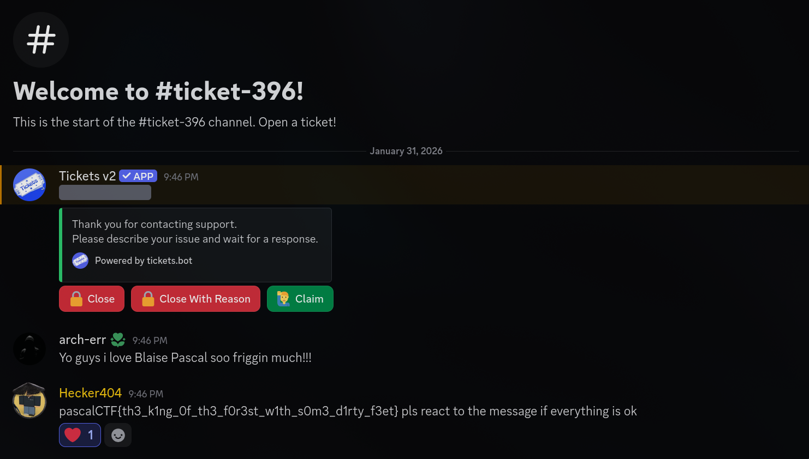

# Stinky Slim

## Description
> *I don't trust Patapim; I think he is hiding something from me.*

**Files:** [pieno-di-slim.wav](./orig/pieno-di-slim.wav)

## Solution
**TL;DR**: Audio spectrogram steganography with social engineering twist
1. Open the WAV file in a spectrogram viewer (sox, Audacity, etc.)
2. Use settings: `sox pieno-di-slim.wav -n spectrogram -x 10000 -y 400 -z 85`
3. Read the text visible in the spectrogram: "OPEN A TICKET SAYING YOU LOVE BLAISE PASCAL TO GET THE FLAG"
4. Open a support ticket on the CTF platform expressing love for "BLAISE PASCAL"
7. Receive the flag from the organizers

### Flag
> `pascalCTF{th3_k1ng_0f_th3_f0r3st_w1th_s0m3_d1rty_f3et}`
